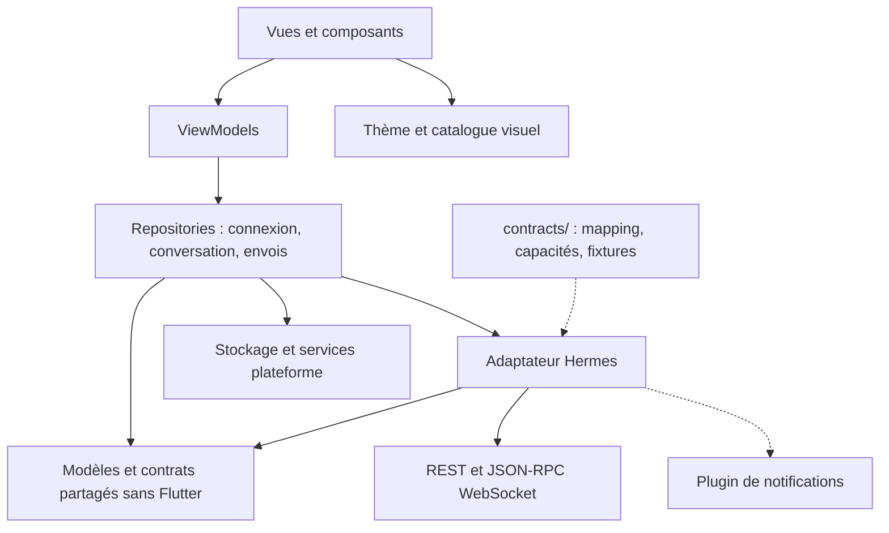
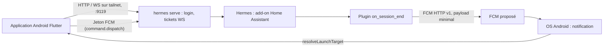

# Hermes Mobile — architecture pour les agents de développement

**Proposition en mode rapide.** `[ADOPTED]` signale une contrainte déjà décidée par Alanc, `[ASSUMPTION]` un choix proposé. Les autres règles forment le contrat technique. Le point d'entrée Hermes a été identifié dans le code de l'add-on installé, mais la compatibilité réelle n'est certifiée qu'après les essais de G1 sur téléphone. Les portes G1 à G4 délimitent le travail autorisé en aval.

## Paradigme et dépendances

**MVVM léger** : les vues affichent, les ViewModels gèrent les interactions, les repositories portent l'état et les services gèrent le réseau et la plateforme. Un adaptateur unique traduit Hermes vers les modèles partagés, et le point de composition assemble les dépendances. Les ViewModels sont des `ChangeNotifier`, à la manière du guide d'architecture Flutter. Les repositories exposent des `Stream` de snapshots immuables. Aucun autre framework d'état n'est utilisé.



## Invariants et règles

### AD-1 — Autorité du serveur [ADOPTED]

- **Binds:** toutes les capacités, mobile et plugin de notifications.
- **Prevents:** deux moteurs d'agent, deux historiques, une administration mobile parallèle, et un plugin qui agirait sur le travail.
- **Rule:**
  - Hermes possède les profils, l'historique distant, l'exécution, les outils/MCP et la politique d'autorisation. Le mobile transmet les intentions et présente les preuves reçues.
  - Le plugin de notifications tourne dans Hermes, ne soumet ni ne contrôle aucun travail, et ne lit que les paramètres du hook `on_session_end`.
  - Personne n'accède directement aux bases privées de Hermes. Le MVP n'a pas d'écran d'administration des profils.

### AD-2 — Un propriétaire par état [ASSUMPTION]

- **Binds:** tous les modules mobiles.
- **Prevents:** des états contradictoires entre fil, historique, fichiers, arrêt et notification, et deux auteurs pour la même entité.
- **Rule:**
  - `ConnectionRepository` est le seul auteur des connexions, des capacités, de la liste des profils, du profil sélectionné et de l'unique socket par connexion. Les autres modules s'abonnent à son flux et n'ouvrent jamais de socket.
  - `ConversationRepository` est le seul auteur de la projection distante et de la fusion local/serveur (`TimelineProjection`).
  - `OutboxRepository` est le seul auteur des brouillons, des pièces sortantes, de la création de session (`ensureSession(DraftKey)`, sérialisée par brouillon) et des opérations locales (envoi, arrêt, suivi de notification). `ConversationRepository` ne crée jamais de session.
  - Les ViewModels envoient des commandes et lisent des projections. Les vues ne font ni appel réseau ni écriture persistante.
  - Les modèles et contrats sont définis une seule fois, hors Flutter. L'injection est explicite au démarrage, sans service locator global. Un contrôle des imports en CI fait respecter ces frontières.

### AD-3 — Identité et cloisonnement

- **Binds:** FR-2/3/6/8/10, fichiers, stockage, routes et notifications.
- **Prevents:** le mélange de profils, les collisions, la réindexation quand l'URL change et la réaffectation d'un résultat au fil actuellement affiché.
- **Rule:**
  - Les données distantes portent `ConnectionKey + ProfileKey + SessionKey`. `ConnectionKey` est un UUID local stable ; l'URL n'en est qu'un attribut modifiable. Les IDs Hermes restent opaques et sensibles à la casse.
  - Le profil d'un fil existant ne change jamais. Changer de sélection affecte le prochain fil.
  - `DraftKey` est une clé locale distincte de la session. Son association à la session créée est persistée avant la soumission.
  - `OperationKey` (locale) et l'identité d'exécution côté serveur sont deux choses distinctes ; une identité distante absente reste absente.
  - Le payload push ne porte que `sessionId` (identifiant stocké de la conversation) et l'issue.
  - Si la découverte des profils échoue, aucun profil par défaut n'est inventé : le défaut vient de Hermes ou du dernier choix explicite enregistré.

### AD-4 — Projection réconciliée par un mapping unique

- **Binds:** FR-4/7/8/12, projection mobile.
- **Prevents:** les doublons, les événements tardifs appliqués, les fins fictives.
- **Rule:**
  - Une table déclarative dans `contracts/` fait correspondre les événements Hermes aux états, aux terminaux et à `ActivityKind`. Le mobile la consomme, validée par le jeu de fixtures. Le catalogue visuel ne lit que `ActivityKind`.
  - Le repository sérialise les mutations par session et enregistre en une seule fois la projection et son curseur.
  - Le curseur `(epoch, seq)` n'est utilisé que si la capacité est détectée sur le build installé. Sinon, la reprise se fait par snapshot complet.
  - Les doublons sont écartés avant application. Un trou, une troncature ou un nouvel epoch imposent un snapshot. Les événements d'une ancienne connexion ou session sont écartés.
  - Le rapprochement local/serveur ne repose jamais sur le texte : la règle est fixée en G1.
  - La connexion et le travail sont deux états distincts. Fin de socket, animation et silence réseau ne prouvent jamais la fin du travail. Les événements d'outil ne permettent pas de déduire un raisonnement privé.

### AD-5 — Soumission et arrêt sans répétition implicite

- **Binds:** FR-4/8/12, NFR-2.
- **Prevents:** une double exécution après un timeout ou un nouveau rendu, et l'arrêt du tour suivant à la place du tour visé.
- **Rule:**
  - Avant la soumission, l'opération est persistée avec sa cible, son contenu exact et ses références de fichiers. Le pipeline d'envoi suit des étapes nommées et ordonnées : `ensureSession`, pièces, suivi de notification (non bloquant), soumission.
  - Si le résultat est incertain, le brouillon est conservé et l'opération passe à `unknown`, sans renvoi automatique.
  - Une mutation n'est répétée que si son idempotence est démontrée pour cette méthode et cette version (capacité détectée), avec la même clé et le même contenu dans la fenêtre de validité. Un ID JSON-RPC n'est pas une clé d'idempotence.
  - Un seul nouvel envoi mobile à la fois par session. Pendant le travail, la saisie est conservée et n'est pas soumise.
  - L'arrêt est une opération persistée qui vise l'exécution observée. Si le contrôle ne peut viser qu'une session, une commande ancienne n'est jamais rejouée après un changement de tour.
  - `stopRequested` vient de cette opération et n'est jamais écrit dans la projection. Seul le serveur fournit un terminal. Les effets déjà produits ne sont pas annulés.

### AD-6 — Pièces jointes reçues avant utilisation

- **Binds:** FR-5/6 ; FR-14 s'il est retenu.
- **Prevents:** des pièces fictives, l'envoi au serveur de chemins du téléphone et les fuites entre fils.
- **Rule:**
  - Les octets sélectionnés sont copiés dans l'espace privé de l'app (`attachments/<DraftKey>/`). Les résultats téléchargés vont dans un emplacement séparé.
  - Le type, le nombre et la taille sont validés contre la limite la plus restrictive vérifiée parmi app, proxy, Hermes et modèle.
  - Le prompt ne part qu'après confirmation de toutes les pièces retenues, avec leurs références serveur dans le scope d'origine. Un upload échoué ou incertain bloque le prompt. Un upload réussi ne prouve pas que le modèle a analysé le fichier.
  - Un résultat n'est disponible qu'une fois résolu un accès authentifié pour son profil et sa session. Un chemin serveur ne vaut pas téléchargement.
  - Aucun fichier n'est jamais exécuté automatiquement.

### AD-7 — Contrat d'intégration unique [ASSUMPTION]

- **Binds:** connexion, profils, historique, envoi, activité, fichiers, arrêt et jeton de notification.
- **Prevents:** les endpoints inventés, des sessions différentes selon le transport, et des fonctionnalités prises sur un HEAD amont absent de l'add-on.
- **Rule:**
  - [ADOPTED] L'unique point d'entrée est le backend officiel Hermes Desktop (`hermes serve`), que l'add-on lance avec `enable_desktop_backend` sur le port 9119 : REST pour les ressources, JSON-RPC sur `/api/ws` pour la conversation. L'ingress Home Assistant (`:8123`), les ports 8080/8443 et `/v1/` ne servent pas le mobile. Seuls l'adaptateur et le plugin de notifications connaissent les noms et formats Hermes.
  - Un même fil n'est jamais réparti entre l'API OpenAI, le PTY et un accès base.
  - La référence est le tag de release amont correspondant au build installé, jamais HEAD. `info.version` ne suffit pas : les capacités optionnelles (`replay_epoch`, `idempotency_key`, `file.attach`…) sont détectées à la connexion et enregistrées par `ConnectionRepository`.
  - Avant les stories d'intégration, on fige le contrat, des échanges anonymisés et des fixtures de traduction.
  - Une méthode absente, un refus d'authentification et une panne transitoire produisent des erreurs distinctes.
  - Une capacité obligatoire manquante bloque l'intégration ; elle n'est pas retirée du MVP.

### AD-8 — Réseau privé et authentification distincts

- **Binds:** FR-1, NFR-3, fichiers, liens et diagnostics.
- **Prevents:** une autorisation implicite par Tailscale, la perte du préfixe d'ingress et les fuites de secrets.
- **Rule:**
  - Tailscale fournit le réseau. Hermes authentifie les appels et les sockets ; le jeton FCM passe par cette connexion authentifiée.
  - [ADOPTED] Authentification Hermes : le login par mot de passe du plugin Basic (utilisateur `hermes`, mot de passe `access_password` de l'add-on) donne un jeton d'accès (12 h) et un jeton de refresh (30 j). Les sockets s'ouvrent avec un ticket WS. On utilise ce flux du framework Hermes, sans en inventer un autre.
  - Le secret de signature est régénéré à chaque redémarrage du backend, ce qui invalide tous les jetons. [ADOPTED] Le mobile garde donc le mot de passe dans le stockage sécurisé et se reconnecte seul quand le refresh échoue, sans demander à nouveau le mot de passe.
  - [ADOPTED] Origine : `http://<hôte>.ts.net:9119`, en HTTP sur le tailnet, où WireGuard chiffre le trafic. Android interdit le clair par défaut : une exception `network_security_config` est limitée aux sous-domaines `ts.net`, et l'app refuse toute URL `http://` hors `*.ts.net`. L'app accepte aussi une origine `https://`, pour qu'un passage ultérieur à Tailscale Serve ne demande qu'un changement d'URL.
  - Appairage par QR code ou par saisie manuelle de l'URL. Le QR suit le format `hermes-mobile://pair?url=<origine>` : il contient seulement l'origine, jamais le mot de passe ni un jeton. Après le scan, l'app affiche l'origine pour confirmation, puis le mot de passe est saisi une fois. Le QR est généré une fois hors de l'app, par un petit script du dépôt ou n'importe quel générateur. Un QR ou un lien ne connecte jamais sans contrôle de l'origine et sans authentification.
  - Les secrets vont dans le stockage sécurisé de la plateforme, sous la clé `<ConnectionKey>/<usage>`. Ils n'apparaissent jamais dans les URL persistées, les notifications, les diagnostics ni les sauvegardes (`allowBackup=false`).
  - Après une révocation, l'app se réauthentifie sans contourner les contrôles Host/origin ni les tickets.
  - Une redirection ou un téléchargement vers une autre origine ne reçoit jamais les credentials Hermes.

### AD-9 — Notification par plugin Hermes [ADOPTED 2026-10-29]

- **Binds:** FR-8/9, plugin Hermes et retour vers le fil.
- **Prevents:** une notification qui dépendrait d'une socket mobile, un envoi bloqué par le suivi, et un service à installer en plus de Hermes.
- **Rule:**
  - Un plugin Hermes `on_session_end` par profil notifie les fins de tour `platform: tui` via FCM HTTP v1, dans un fil en arrière-plan (hook borné à 30 s par Hermes). Sous-agents, cron et autres plateformes ne notifient pas.
  - Le mobile transmet son jeton FCM par `command.dispatch hermes-mobile-token` à chaque envoi, sans jamais bloquer. Une réponse 4018 (plugin absent) marque le tour « notification non suivie ».
  - Le payload contient seulement `{outcome, sessionId}` et un libellé générique. Le mobile recharge après authentification. Aucun texte de conversation, chemin ou secret n'est transmis au fournisseur.
  - Le compte de service reste dans `HERMES_HOME/hermes-mobile/`, hors dépôt. Un jeton refusé (`UNREGISTERED`) est oublié jusqu'au prochain envoi ; une erreur réseau donne un seul nouvel essai.
  - [ACCEPTÉ] Ni outbox durable ni rattrapage : un plantage de Hermes en plein tour perd la notification. Aucune livraison exactement une fois n'est promise.
  - L'app gère l'ouverture à froid et à chaud par `sessionId` et la rotation du token.
  - Remplace l'observateur serveur des stories 5.1 à 5.4 (proposition de changement du 2026-10-29).

### AD-10 — Refonte limitée à la présentation [ADOPTED]

- **Binds:** toute l'UI, FR-7, NFR-1.
- **Prevents:** des styles dispersés, un design couplé au protocole et une animation qui déciderait de l'état réel.
- **Rule:**
  - Une source unique de tokens sémantiques et un thème système clair/sombre avec palette dynamique Android, plus un secours centralisé.
  - Les composants exposent des interfaces données/actions explicites. Le catalogue d'activités est indexé par `ActivityKind`, jamais par emoji ou minuterie, avec un fallback générique. Le détail visuel relève de DESIGN.md.
  - Les animations ne modifient aucun état distant, et le mouvement réduit est respecté.
  - L'accessibilité est préservée : lecteur d'écran, texte agrandi, clavier, cibles tactiles et noms accessibles, dont Arrêter. Aucun état n'est exprimé seulement par la couleur.
  - Une galerie de fixtures couvre les variantes accessibles, et les libellés sont séparés des styles.

### AD-11 — Exploitation et évolution sans changer l'autorité

- **Binds:** stockage, déploiement, mises à jour, diagnostics et CI.
- **Prevents:** des migrations qui corrompent Hermes, des tests sur données personnelles et une rupture silencieuse après une mise à jour.
- **Rule:**
  - Le mobile utilise un seul fichier SQLite, avec des tables préfixées par leur repository propriétaire et un registre de migrations en ajout seul, testées. Aucun agent ne migre Hermes.
  - L'add-on est supervisé par Home Assistant ; le plugin de notifications vit dans son `HERMES_HOME`, profil par profil.
  - Fixtures/tests, intégration et instance personnelle sont isolés. Les essais avec effets se font uniquement dans un profil dédié. Clés, bases et destinations push sont séparées par environnement.
  - Après une mise à jour de Hermes, le contrat, les capacités et la reprise sont revérifiés avant de déclarer la compatibilité. Au démarrage, l'app compare les capacités détectées avec celles qu'elle exige et affiche un écart au lieu d'échouer silencieusement.
  - Les logs utilisent des codes namespacés (`domaine.code`) et des identifiants locaux de corrélation, sans contenu conversationnel ni credentials par défaut.
  - L'APK est privé, signé et versionné, installé manuellement. Les secrets de signature et FCM restent hors du dépôt.
  - La CI fait tourner l'analyse, les tests, le contrôle des imports et un build Android.

## Conventions communes

| Sujet | Convention |
| --- | --- |
| Erreurs | Enveloppe partagée `code` (namespacé), `retryable`, `operationKey?`. Le texte utilisateur est distinct du diagnostic expurgé. `retryable` seul n'autorise pas une mutation. |
| Ordre | Dates UTC ISO 8601 à la frontière. Ordre causal fourni par le serveur, jamais par l'horloge du téléphone. |
| Activité | Identité d'action serveur, `ActivityKind` issu du mapping et état. Un type inconnu est conservé et rendu génériquement ; un détail manquant reste absent. |
| États partagés | Trois familles distinctes. Acceptation locale : `draft`, `preparing`, `sending`, `accepted`, `unknown`, `failed`. Connexion : `connecté`, `resynchronisation`, `hors ligne`. Travail distant : `queued`, `running`, `waitingInput`, `waitingApproval`, `succeeded`, `failed`, `stopped`, `unknown`. Les états d'attente ne sont activés que si G4 les retient et si Hermes les expose. `stopRequested` est une opération ; un terminal vient du serveur. |
| Navigation | Une table unique de routes typées, par exemple `/c/<ConnectionKey>/<ProfileKey>/<SessionKey>` et `/draft/<DraftKey>`. Un seul `resolveLaunchTarget()` décide dans l'ordre : notification, puis restauration, puis accueil. |
| Accueil | [ASSUMPTION] Au démarrage normal, un brouillon sur le profil par défaut, sans historique vide. La session est créée par `ensureSession` au premier envoi ou staging. Un retour temporaire conserve l'écran en cours. |
| Brouillons | Clé connexion/profil/fil, ou nouveau brouillon. Seule la version acceptée est retirée, jamais une saisie plus récente. Les pièces sont conservées jusqu'au rapprochement. |
| Notifications | Un indice pour recharger, jamais une autorité sur l'état. Une permission refusée ou des prérequis absents sont expliqués ; FR-9 reste requis. |

## Stack de départ

**[ADOPTED]** Flutter est confirmé par Alanc, à condition que le bootstrap compile et tourne correctement sur son téléphone Android. Sinon, le choix de stack revient à Alanc avant toute story. Versions candidates vérifiées le 20 octobre 2026, sans résolution conjointe ni compilation. Le SDK épinglé et le lockfile deviendront la référence du code. [Sources](integration-evidence.md).

| Name | Version |
| --- | --- |
| Flutter, starter officiel minimal | 3.47.x (dernier correctif au bootstrap, 3.47.7 le 20/10) |
| dynamic_color | 2.1.0 |
| sqflite | 2.4.4+2 |
| flutter_secure_storage | 11.2.0 (minSdk 23, `allowBackup=false`) |
| firebase_messaging + firebase_core, sous réserve de G3 | 17.0.0 + ^5.0.0 (minSdk 24), ou 16.x si 17 n'est pas stable en G3 |

Dart est celui fourni par le Flutter épinglé. minSdk Android : 24. Pour le Markdown, ne pas utiliser `flutter_markdown`, qui est abandonné. La graine est `flutter create --empty --platforms=android,ios hermes_mobile`. Aucune application n'a été initialisée pendant cette étude.

## Graine structurelle et déploiement



Le plugin de notifications s'installe dans le `HERMES_HOME` de chaque profil. G1 détermine le chemin réseau réel. Le modèle et les MCP restent connectés par Hermes. Environnements : fixtures locales sans secrets, intégration sur un profil de test, usage réel sur l'add-on personnel.

```text
hermes_mobile/lib/
  app/             # composition, routes, resolveLaunchTarget
  models/          # identités, états et contrats sans Flutter
  data/            # repositories, adaptateur, stockage, plateformes
  features/        # vues et ViewModels
  ui/              # tokens, thème, composants, catalogue
contracts/         # contrat épinglé, capacités, mapping événements→états, fixtures anonymisées
server/hermes-plugin/  # plugin Hermes de notifications (on_session_end → FCM)
```

## Couverture du PRD

| Capacité | Responsable logique | Règles |
| --- | --- | --- |
| FR-1 accès | Connexion, auth, adaptateur | AD-7/8 |
| FR-2/3/10 accueil, profils, historique | Connexion, conversation, outbox | AD-1/2/3/5/7 |
| FR-4 texte long et rendu | Conversation, saisie, projection | AD-2/4/5/10 |
| FR-5/6 fichiers et images | Outbox, pièces du message | AD-3/6/8 |
| FR-7 actions dépliables | Mapping, projection et catalogue | AD-4/10 |
| FR-8 continuité | Hermes, opérations, réconciliation | AD-1/4/5/11 |
| FR-9 notification | Plugin Hermes, push, routage | AD-3/9/11 |
| FR-12 arrêt | Opération d'arrêt ciblée et confirmation | AD-4/5/7 |
| FR-13/14 proposés | Intervention/résultat après G4 | AD-1/3/5/6/7 |
| NFR-1..4 | Accessibilité, fiabilité, accès, compatibilité | AD-4/5/7/8/10/11 |

## Portes de validation

| Porte | Preuve / décision attendue | Ce qu'elle bloque |
| --- | --- | --- |
| G1 — installation | Déjà connu : add-on `WolframRavenwolf/hermes-ha-addon` 1.3.9, `hermes serve` sur 9119 (vérifié dans le code). Reste à prouver : `enable_desktop_backend` actif et port 9119 mappé, tag Hermes installé et capacités détectées, `http://homeassistant.tail0ec6c6.ts.net:9119` joignable depuis le téléphone, login et ticket WS, deux profils, historique, envoi, reprise après redémarrage du backend, arrêt, et règle de rapprochement local/serveur. | Les stories d'intégration au-delà de la capture du contrat, qui est la première d'entre elles, et toute compatibilité déclarée. L'UI isolée sur fixtures peut avancer. |
| G2 — fichiers | Limites et réception dans le bon fil. Corpus d'Alanc (long texte, image, PDF, document bureautique) avant les tests d'acceptation. | Stories fichiers sans contrat vérifié, puis acceptation de FR-4/5/6. |
| G3 — notification | Plugin installé par profil, jeton app → plugin, filtre `tui`, version FCM, prérequis Android. Essais app fermée, coupure réseau, arrêt, sous-agent, reprise de conversation, `/new`, plugin absent. **Statut 2026-10-30 : ouverte** (plugin ≥ 1.0.2 requis) — plugin absent non détecté, `/new` non jouable ([rapport](../../../implementation-artifacts/story-5-5-verification/rapport-g3.md)). | Acceptation de FR-8/9 sur téléphone réel. |
| G4 — produit/UX | Alanc tranche FR-13/14, les interventions en cours et les issues notifiées. L'UX précise le secours de thème et les parcours ouverts. | Stories concernées, sans bloquer le socle indépendant confirmé. |

**Essai global 6.5 (2026-10-30) : story clôturée sur décision d'Alanc, contrôles restants reportés pour passer à l'epic 7 ; acceptation technique réelle ouverte.** Le
[rapport courant](../../../implementation-artifacts/story-6-5-verification/rapport-mvp.md)
sépare les nouveaux constats des preuves historiques. G1/G2 attendent le
rapprochement des parcours mobiles ; G3 reste ouverte avec tous ses écarts
existants. G4 est fermée par les décisions d'Alanc du 2026-10-30 (FR13/14
retenus et palette de secours validée, voir `contracts/README.md`) ; cette
décision ne prouve pas l'exécution réelle des interventions et résultats.
Un contrôle obligatoire non joué ou échoué interdit l'acceptation sans
retrait ou report explicite d'Alanc consigné au rapport.

Vérifications du contrat :

- IDs similaires sur deux profils.
- Coupure après acceptation, avant la réponse.
- Événement dupliqué, tronqué ou ancien.
- Arrêt après reconnexion.
- Upload échoué sans prompt.
- Fin pendant que l'app est fermée.
- Plugin absent pendant un envoi.
- Changement d'URL d'une connexion sans réindexation.

Refus de permission, arrêt forcé Android et absence des prérequis Google sont des cas distincts de la veille normale. Une incapacité obligatoire revient à Alanc ; aucune simulation ne vaut acceptation réelle.

## Différé

- **Après G1 :** schémas réseau, auth, limites et mapping exact dans `contracts/`, avec un seul propriétaire. Aucun agent ne les choisit séparément.
- **Avant les écrans concernés :** tokens, secours de palette, navigation et focus, sous AD-10.
- **Au bootstrap :** les paquets réseau, fichiers, Markdown et routage sont choisis centralement, épinglés, résolus ensemble et compilés pour Android avant leurs stories.
- **Plus tard, si simple :** HTTPS via Tailscale Serve devant le port 9119. Dans l'add-on Tailscale de Home Assistant, cela passe par l'option `services` (tags, approbation admin), ce qui n'est pas trivial. Côté app, seule l'URL change.
- **Avant iPhone :** signature et build Apple, push iOS via APNs. Aucune parité n'est annoncée sans test.
